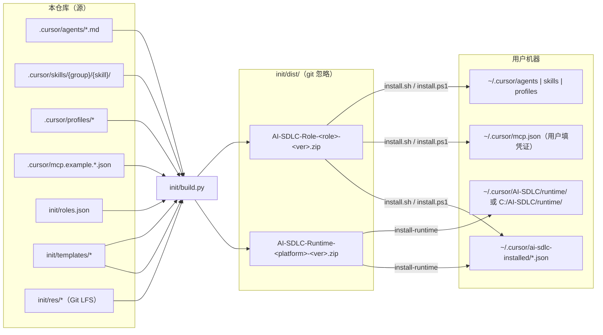

# ai-sdlc 维护手册（KT 入口）

本目录面向**仓库维护者**（接手 / KT / 日常改 Agent·Skill·profile·打包脚本的人），回答「这个仓库怎么维护」。
面向最终用户的安装说明在 [`init/README.md`](../../init/README.md)，总体设计意图在 [`doc/AI-Toolchain-Design.md`](../AI-Toolchain-Design.md)，总规则在 [`AGENTS.md`](../../AGENTS.md)。

## 0. 第一原则：代码是 source of truth

文档会过期，代码不会撒谎。**任何文档与下表「权威来源」冲突时，以权威来源为准，并顺手修文档。**
本目录的文档尽量只写「流程与原因」，清单类信息一律指向权威文件，不重复抄写。

| 想知道 | 权威来源（以它为准） | 不要以它为准 |
| --- | --- | --- |
| 有哪些 Agent / Skill | `.cursor/agents/*.md`、`.cursor/skills/<group>/<skill>/`（分组目录只做组织，skill 名取 `SKILL.md` 所在目录） | 任何文档里的表格 |
| 哪个角色装哪些 Agent / Skill / profile | [`init/roles.json`](../../init/roles.json) | `AGENTS.md` §3、`init/README.md` 角色表、设计文档 §5 / §6 |
| Agent / Skill 做什么、何时触发 | 各自 frontmatter 的 `description` 与正文 | 设计文档 §2 / §4（是设计意图，可能领先或落后实现，如 `kb-query` 仅为规划） |
| 团队差异（Jira / Confluence / 仓库 / 命令 / 流水线） | `.cursor/profiles/<team>-<env>.yaml`（字段含义写在 yaml 注释里） | Skill 正文里的示例值 |
| 打包内容、包结构、manifest 字段 | [`init/build.py`](../../init/build.py) | `init/README.md` |
| 安装 / 卸载行为 | `init/templates/*.sh` / `*.ps1` | `init/README.md` |
| 运行时版本与路径 | `.cursor/profiles/setup.json`、`.cursor/mcp.example.*.json`、`init/res/` 下的载荷文件名 | — |
| 当前版本号 | git tag + `pyproject.toml` 的 `version` | — |
| 哪些文件入库 / 走 LFS | `.gitignore`（根、`.cursor/`、`init/`）、`.gitattributes`、`git ls-files` | — |

**一致性检查脚本** [`init/check.py`](../../init/check.py) 把上表里「文档说的」和「代码有的」机器对一遍，改完任何东西都先跑：

```bash
python init/check.py           # ERROR 即失败
python init/check.py --strict  # 发版前用：WARN 也算失败
```

## 1. 文档索引

| 文档 | 什么时候看 |
| --- | --- |
| [change-checklist.md](change-checklist.md) | 要新增 / 修改 / 改名 / 删除 Agent、Skill、profile 字段、脚本、安装模板、运行时时——**改了 X 还要同步哪里** |
| [release.md](release.md) | 发版：git flow、版本号、构建、分发、回滚；以及日常分支 / commit 约定 |
| [profiles.md](profiles.md) | 理解和修改团队 profile（结构、test/prod 差异规则、加字段流程、消费方查找） |
| [testing.md](testing.md) | 提交前要验证什么、如何在本机装上改动后的包实测、跨平台验证 |
| [troubleshooting.md](troubleshooting.md) | 用户或自己遇到问题时的定位路径 |
| [`/CHANGELOG.md`](../../CHANGELOG.md) | 每个版本改了什么、升级时要不要先卸载 |

## 2. 五分钟心智模型



要点（规则本身见 [`AGENTS.md`](../../AGENTS.md) §5 与 [`init/README.md`](../../init/README.md)，这里只给全局图景）：

1. **Agent → Skill → MCP 三层**，APP / CMS 共用一套逻辑，差异只进 profile。
2. **`roles.json` 是打包的唯一数据源**：没登记的资产不会被打包，也不会进卸载清单。
3. **两类包互相独立**：运行时包每台机器装一次；角色包内容更新就重装。
4. **角色包安装只覆盖、不删除**：所以每个版本都要在 CHANGELOG 写清「升级方式」，规则见 [`init/README.md`「升级与重装」](../../init/README.md#升级与重装直接覆盖-vs-先卸载)。

## 3. 本仓库开发时的坑

在本仓库里调试时，仓库级与用户级 Skill 会同时加载、仓库内脚本按自身位置找配置——容易「改了没生效」或「找不到凭证」。必读 [testing.md §3](testing.md#3-在-cursor-里实测-agent--skill)。

## 4. KT 建议路径

1. 读 [`AGENTS.md`](../../AGENTS.md) 全文（约 10 分钟）。
2. 读本页 + [change-checklist.md](change-checklist.md)。
3. 打开 `init/roles.json`，对照 `.cursor/agents/` 与 `.cursor/skills/` 看一遍；挑一个 Agent（推荐 `dev-agent`）读完它调用的 Skill 链。
4. 本地跑：`python init/check.py`、`python init/build.py --no-zip --yes`、`python .cursor/skills/common/sensitive-data-guard/tests/run_tests.py`，看懂输出。
5. 读一份 profile（`app-test.yaml`）的注释，理解 `mcp` / `code` / `review` / `test` / `doc` 五段分别给谁用。
6. 读 [`CHANGELOG.md`](../../CHANGELOG.md) 了解演进历史和踩过的坑。
7. 按 [testing.md](testing.md) §3 在本机装一次自己构建的角色包，跑通一个 Agent。
